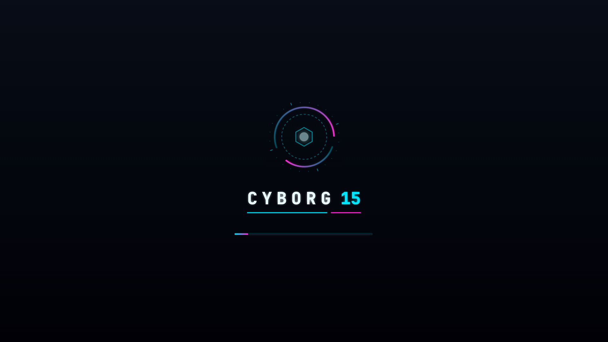
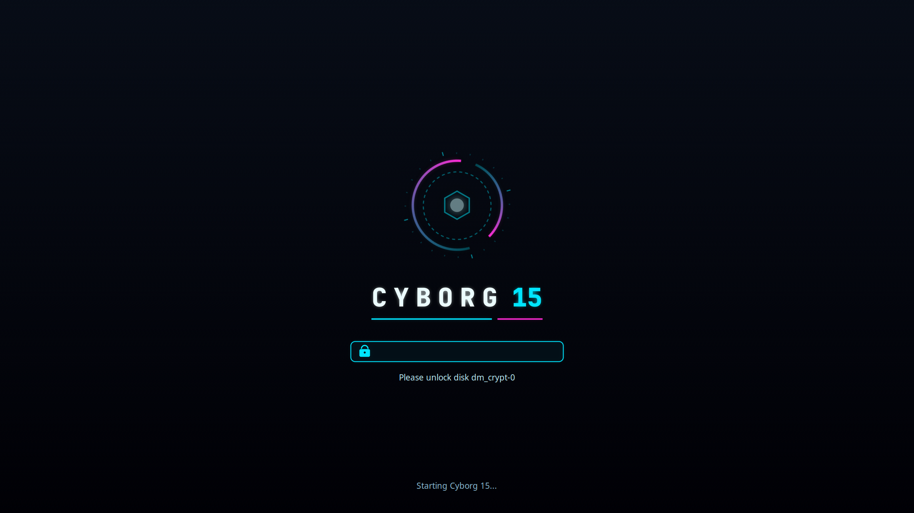

# cyborg15-plymouth

A neon boot splash (Plymouth theme) for the MSI Cyborg 15 on Ubuntu, with a styled LUKS unlock prompt.

| Boot | Disk unlock |
|---|---|
|  |  |

## What it shows

- **Rings:** the outer ring spins with a cyan-to-magenta trail, and the dashed inner ring
  turns the other way.
- **Core:** a hex core in the middle pulses.
- **Progress bar:** shown during boot. When the disk needs unlocking (LUKS), it's replaced
  by a password box, with one dot per character typed.
- **Shutdown / reboot:** shows `SHUTTING DOWN` or `REBOOTING` instead of the bar.
- **Scaling:** everything scales to the screen height, and the design is based on 1080p.

## Install / remove

```bash
./install.sh      # copy the theme, set it as default, rebuild the initramfs
./preview.sh      # watch it in a window without rebooting (sudo apt install plymouth-x11)
./uninstall.sh    # back to the stock theme
```

To change the look, edit `tools/make-assets.py` and run it again:

```bash
python3 tools/make-assets.py cyborg
./install.sh
```
